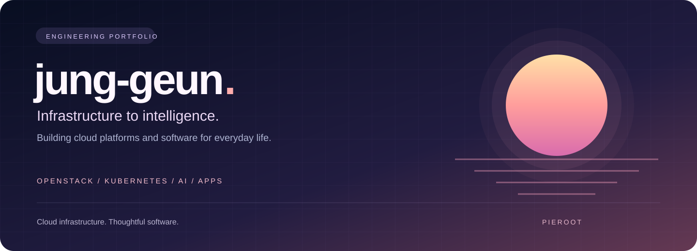
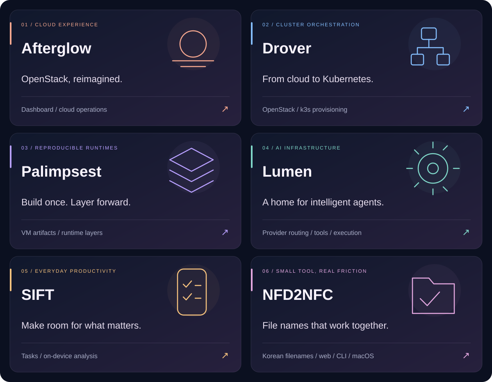

<b>English</b> &nbsp; / &nbsp; <a href="./README.ko.md">한국어</a>

  

## Building the platform. Crafting the experience.

I'm **jung-geun · 봉정근**, a developer working across cloud infrastructure, AI platforms, and practical applications. I connect the systems behind the scenes with the interfaces people use.

My main focus is **[Afterglow](https://github.com/openstack-afterglow)** — an independent open-source ecosystem built around an alternative OpenStack dashboard.

<table>
<tr>
<td width="33%" valign="top"><h3>01 / Cloud</h3>OpenStack operations, Kubernetes provisioning, storage, and reproducible VM environments.</td>
<td width="33%" valign="top"><h3>02 / Intelligence</h3>LLM gateways, agent runtimes, tool integration, and on-device AI.</td>
<td width="33%" valign="top"><h3>03 / Product</h3>Developer tools, native applications, and useful everyday software.</td>
</tr>
</table>

## Selected work

| Explore the source | What it does |
| :--- | :--- |
| **[01 — Afterglow ↗](https://github.com/openstack-afterglow/openstack-afterglow)** | OpenStack dashboard designed as an alternative to Horizon and Skyline. **[Live deployment](https://cloud.dmslab.re.kr)** |
| **[02 — Drover ↗](https://github.com/openstack-afterglow/drover)** | Kubernetes / k3s cluster provisioning on OpenStack. |
| **[03 — Palimpsest ↗](https://github.com/openstack-afterglow/palimpsest)** | Reusable runtime layers, VM artifacts, and declarative local VM workflows. |
| **[04 — Lumen ↗](https://github.com/openstack-afterglow/lumen)** | AI chat and agent infrastructure with provider routing, tools, and durable execution. |
| **[05 — SIFT ↗](https://github.com/jung-geun/SIFT)** | Task management with on-device analysis and optional email and calendar connections. |
| **[06 — NFD2NFC ↗](https://github.com/jung-geun/NFD2NFC)** | Korean filename normalization for the web, CLI, and macOS. **[Try the web tool](https://nfd2nfc.com)** |

**Also building:** [monolog](https://github.com/jung-geun/monolog) — a Notion-backed technical notebook with a VS Code-inspired interface.

## Engineering toolkit

    

| Infrastructure | Platforms & automation | AI & applications |
| :--- | :--- | :--- |
| OpenStack · Kubernetes · k3s | Python · FastAPI · service APIs | LLM & agent runtimes |
| Ceph · Docker · Linux | Provisioning · CI/CD | TypeScript · Swift |
| Kolla-Ansible | Observability | On-device AI |

## From building to sharing

I write about development and infrastructure operations on **[my technical blog](https://blog.pieroot.xyz)**. I care about practical tools, reproducible environments, and learning from real deployments.

**Want to build together?** Explore **[Afterglow](https://github.com/openstack-afterglow)** and check a project's contribution guide or issue tracker. Code, documentation, translations, bug reports, and operational feedback are welcome.

<b>Cloud infrastructure. Thoughtful software.</b> Build → Operate → Learn → Improve

GitHub activity

 

